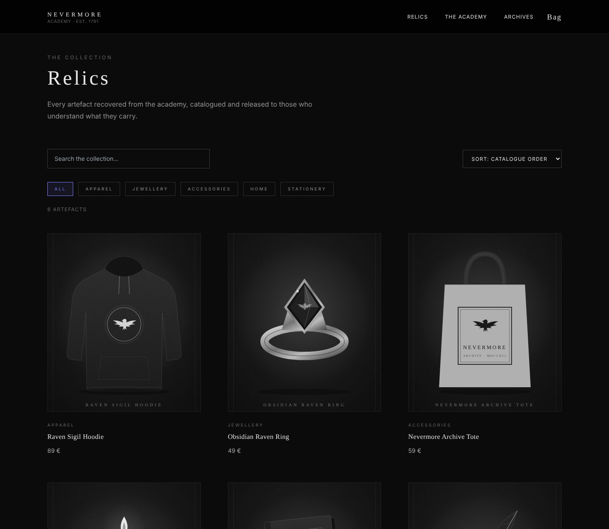
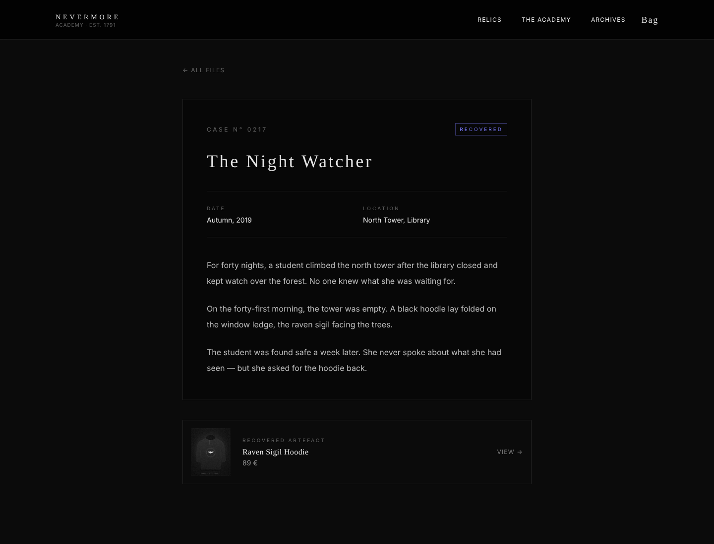

# Nevermore Archives

Boutique en ligne fictive inspirée de l'univers de _Mercredi_. Chaque produit est un « artefact » d'une académie mystérieuse, avec son propre dossier d'archive qui raconte son histoire.

**🔗 Site en ligne : [projet-wednesday.loic-lepreux.com](https://projet-wednesday.loic-lepreux.com)**



## Fonctionnalités

- **Relics** : catalogue complet avec recherche, filtres par catégorie et tri par prix
- **Fiches produits** : description, choix de la taille (sweat), artefacts liés et lien vers le dossier d'archive
- **Archives** : dossiers reliés aux produits, dont un dossier « scellé » au contenu caviardé
- **Academy** : les lieux de l'académie et une chronologie, chaque élément menant à son dossier
- **Panier** : ajout, quantités, tailles, sauvegarde dans le navigateur, notification à chaque ajout
- **Commande** : formulaire de démonstration avec numéro de commande (aucun paiement réel)
- **Animations** : intro au premier chargement, transitions entre les pages, apparitions au défilement
- **Responsive** : menu mobile, mise en page adaptée du téléphone à l'écran large
- **Page 404** dans le thème du site



## Technologies

| Outil                         | Utilisation                                                                    |
| ----------------------------- | ------------------------------------------------------------------------------ |
| **React 19** + **TypeScript** | Interface et typage des données                                                |
| **Vite**                      | Serveur de développement et build                                              |
| **React Router**              | Navigation entre les pages (routes dynamiques `/product/:id`, `/archives/:id`) |
| **Zustand**                   | État global du panier et des notifications, avec sauvegarde (`persist`)        |
| **Framer Motion**             | Intro, transitions de pages et animations au défilement                        |
| **Tailwind CSS**              | Mise en forme                                                                  |

## Organisation des données

Les données sont reliées entre elles, comme dans une base de données :

```
products.ts   ← un produit
archives.ts   ← un dossier, relié à un produit par productId
academy.ts    ← des lieux et des dates, reliés à un dossier par archiveId
```

Une fiche produit retrouve son dossier, un dossier retrouve son produit, et la page Academy mène aux deux.

## Structure

```
src/
├── components/   Header, Footer, ProductCard, Toast, Intro…
├── data/         produits, archives, académie, navigation
├── pages/        Home, Relics, Product, Cart, Checkout, Archives, ArchiveFile, Academy, NotFound
├── store/        panier et notifications (Zustand)
└── types/        types TypeScript
```

## Lancer le projet en local

```bash
git clone https://github.com/loiclepreux/Wednesday-shop.git
cd Wednesday-shop
npm install
npm run dev
```

Puis ouvrir http://localhost:5173

Pour générer la version de production : `npm run build` (le résultat se trouve dans `dist/`).

## À propos

Projet non officiel réalisé à des fins de démonstration pour mon portfolio. Aucun produit n'est réellement vendu. Les visuels des artefacts et le logo sont des créations originales.

**Loïc Lepreux** — [Portfolio](https://loic-lepreux.com) · [GitHub](https://github.com/loiclepreux)
